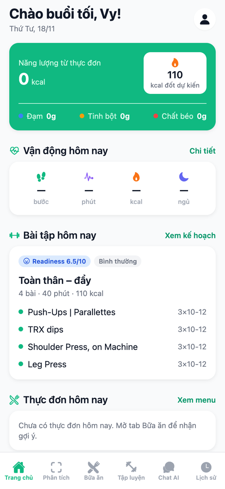
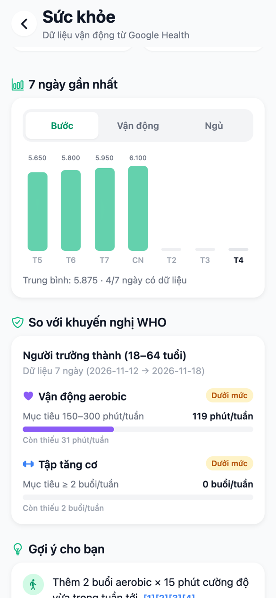
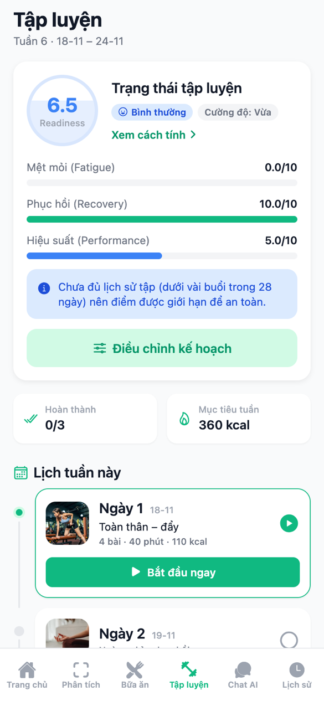
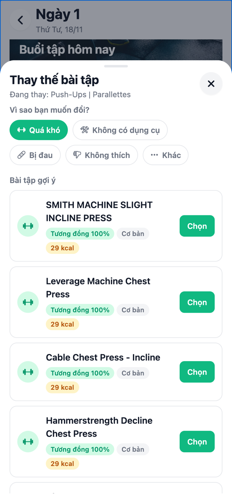
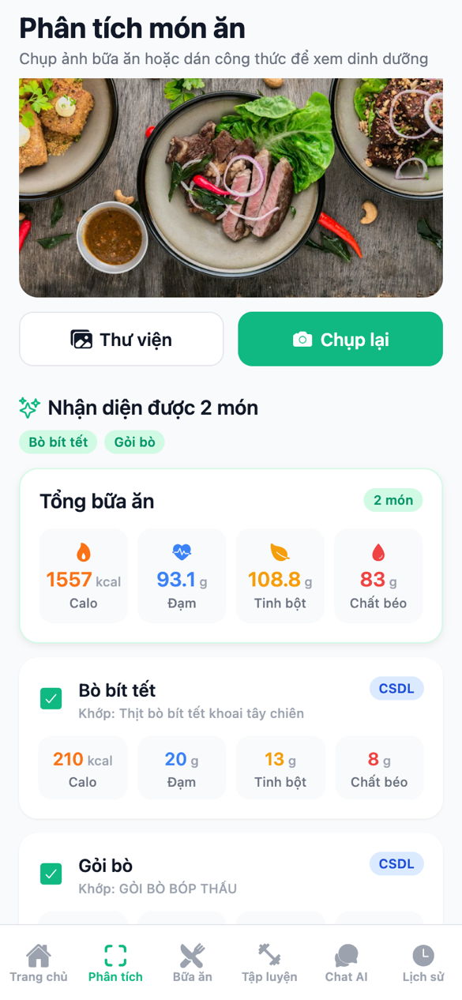
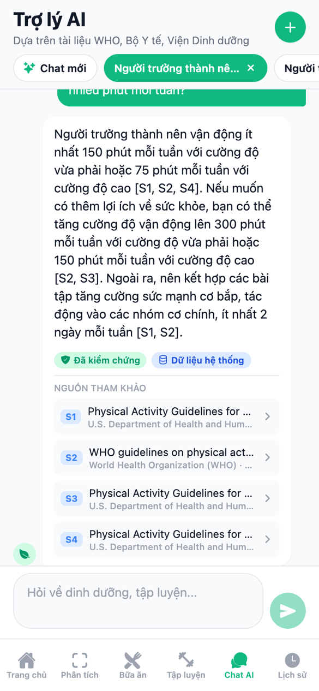

# Nutrition System Mobile - Smart Nutrition Recommendation System

## 1. Introduction

This project is a mobile application for nutrition tracking, developed using React Native.

The application allows users to monitor their daily food intake, track nutritional values, and analyze eating habits over time. 

It is being extended with workout tracking features to provide a more comprehensive health and fitness management experience.

It integrates with a backend system to provide real-time data synchronization, user authentication, and persistent storage.

The goal of this project is to provide a simple and efficient tool for users to manage their diet and improve their health.

---

## 2. Features

- **Dashboard**: today's menu energy and macros, Google Health activity, readiness score and today's workout.
- **Google Health integration**
  - OAuth connection; sync of steps, calories, active minutes and sleep
  - 7-day charts and comparison with WHO physical-activity guidelines, with cited sources
- **Adaptive workout**
  - Fatigue, Recovery, Performance and Readiness scores with a breakdown of how each is computed
  - Plan adjustment preview (increase / maintain / reduce intensity / light session / rest) before applying
  - Exercise substitution: pick a reason and choose from ranked, similar alternatives
- **Food analysis**
  - Multi-dish recognition from one photo (Gemini), with nutrition per dish and a meal total
  - Nutrition analysis from a pasted recipe
- **AI assistant (RAG chatbot)**: answers grounded in WHO, Vietnam Ministry of Health and other official documents, with citations, a "verified" badge and a disclaimer
- **Meal planning**: weekly menu, suggestions, add or remove dishes
- **History**: meals eaten and workout sessions
- **User profile**: body metrics, activity level, goal, dietary restrictions

📖 Vietnamese user guide with screenshots: [docs/huong-dan-su-dung.md](docs/huong-dan-su-dung.md)

---

## Screenshots

<table>
  <tr>
    <td align="center"><br/>Dashboard</td>
    <td align="center"><br/>Google Health vs WHO</td>
    <td align="center"><br/>Adaptive workout</td>
  </tr>
  <tr>
    <td align="center"><br/>Exercise substitution</td>
    <td align="center"><br/>Multi-dish recognition</td>
    <td align="center"><br/>AI assistant with citations</td>
  </tr>
</table>

---

## 3. Technology Stack

- Mobile: React Native (Expo)
- Language: TypeScript / JavaScript
- Navigation: React Navigation (native stack + bottom tabs)
- State Management: React state (hooks)
- API Communication: REST API (Axios / Fetch)
- Backend Integration: Node.js backend system

---

## 4. Project Status

This project is under active development as part of a graduation thesis. Authentication, meal tracking, workout plans, Google Health integration, adaptive workouts, multi-dish food recognition and the RAG chatbot are implemented on mobile.

---

## 5. Planned Features

- Larger knowledge base (30–50 documents) and a more accurate intent router for the chatbot
- Evaluation of chatbot answers (Ragas), multi-dish recognition and recommendations
- Offline support and data caching
- Push notifications for reminders
- Unit and integration testing

---

## 6. System Architecture

The application follows a modular and component-based architecture:

- Screens: Main UI views (Home, Meals, Profile)
- Components: Reusable UI components
- Services: API communication layer
- Navigation: Handles routing between screens

This structure ensures maintainability, scalability, and code reusability.

---

## 7. Backend Integration

This mobile application connects to the backend system:

Backend Repository:
https://github.com/TuUyen038/nutrition-system

The backend provides APIs for:
- Authentication
- User management
- Meal and nutrition data
- Data persistence

---

## 8. Installation and Setup (Local)

### 8.1 Requirements

- Node.js (v16 or later)
- npm or yarn
- Expo CLI

---

### 8.2 Clone the repository

```bash
git clone https://github.com/thvy815/nutrition-system-mobile.git
cd nutrition-system-mobile
```

### 8.3 Install dependencies

```bash
npm install
```

### 8.4 Configure environment variables

Create a `.env` file in the project root:

```bash
# Backend API (use your computer's LAN IP when testing on a real phone)
EXPO_PUBLIC_API_BASE_URL=http://192.168.1.100:3000/api
# Ingredient nutrition lookup service (search-service)
EXPO_PUBLIC_SEARCH_SERVICE_URL=http://192.168.1.100:8000
# Optional: run with built-in sample data, without a backend
# EXPO_PUBLIC_DEMO=1
```

For Google Health, the backend needs `GOOGLE_CLIENT_ID`, `GOOGLE_CLIENT_SECRET` and `GOOGLE_REDIRECT_URI` (pointing to `/api/google-health/callback`). The app passes its own deep link (`nutritionsystem://` or `exp://` in Expo Go) so the browser returns to the app after consent.

### 8.5 Run the application

```bash
npm start          # Expo dev server (scan the QR code with Expo Go)
npm run android    # Android emulator / device
npm run ios        # iOS simulator
npm run web        # Browser preview
```

## 9. Deployment

The application can be run using Expo on mobile devices or emulators.

Future deployment may include publishing to app stores.

## 10. Notes

This project was developed as part of a team-based academic project in a Software Engineering course.

It demonstrates practical experience in building a mobile application, integrating frontend and backend systems, and applying real-world development practices
