# Hướng dẫn sử dụng ứng dụng

Tài liệu này hướng dẫn cách dùng từng tính năng của ứng dụng di động chăm sóc sức khỏe cá nhân. Ảnh minh họa được chụp từ ứng dụng chạy với dữ liệu thật của một tài khoản thử nghiệm.

**Mục lục**

1. [Đăng nhập](#1-đăng-nhập)
2. [Trang chủ](#2-trang-chủ)
3. [Sức khỏe – Google Health](#3-sức-khỏe--google-health)
4. [Tập luyện thích ứng](#4-tập-luyện-thích-ứng)
5. [Phân tích món ăn](#5-phân-tích-món-ăn)
6. [Trợ lý AI](#6-trợ-lý-ai)
7. [Thực đơn](#7-thực-đơn)
8. [Lịch sử](#8-lịch-sử)
9. [Câu hỏi thường gặp](#9-câu-hỏi-thường-gặp)

Thanh điều hướng dưới cùng có 6 tab: **Trang chủ, Phân tích, Bữa ăn, Tập luyện, Chat AI, Lịch sử**. Màn **Sức khỏe** và **Hồ sơ** mở từ Trang chủ.

---

## 1. Đăng nhập

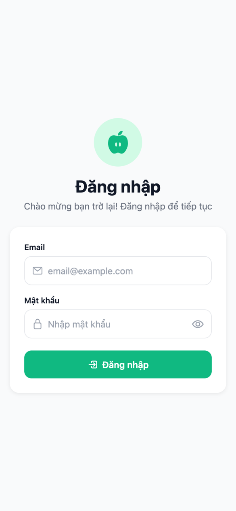

- Nhập email và mật khẩu đã đăng ký, bấm **Đăng nhập**.
- Bấm biểu tượng con mắt để hiện hoặc ẩn mật khẩu.
- Tài khoản phải xác minh email trước khi đăng nhập.

---

## 2. Trang chủ

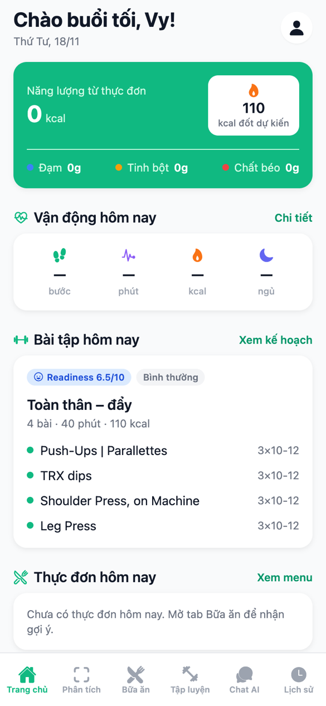

Trang chủ tóm tắt ngày hôm nay:

- **Năng lượng từ thực đơn**: tổng calo và đạm, tinh bột, chất béo của thực đơn hôm nay, cùng lượng calo dự kiến đốt từ buổi tập.
- **Vận động hôm nay**: bước chân, phút vận động, calo tiêu hao và giấc ngủ lấy từ Google Health. Bấm **Chi tiết** để mở màn Sức khỏe.
- **Bài tập hôm nay**: điểm sẵn sàng (Readiness), trạng thái cơ thể và danh sách bài tập. Bấm **Xem kế hoạch** để sang tab Tập luyện.
- **Thực đơn hôm nay**: các món theo từng bữa.
- Biểu tượng người ở góc phải mở **Hồ sơ**.

Kéo màn hình xuống để làm mới dữ liệu.

---

## 3. Sức khỏe – Google Health

  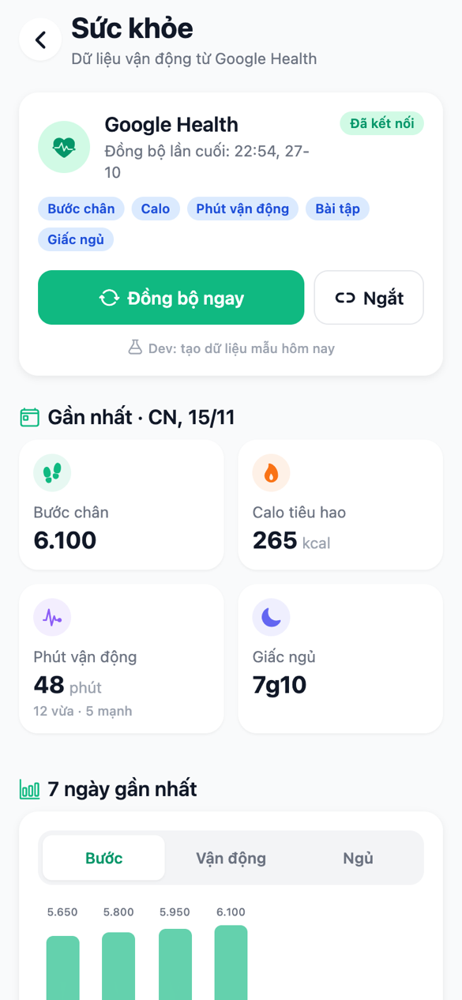
  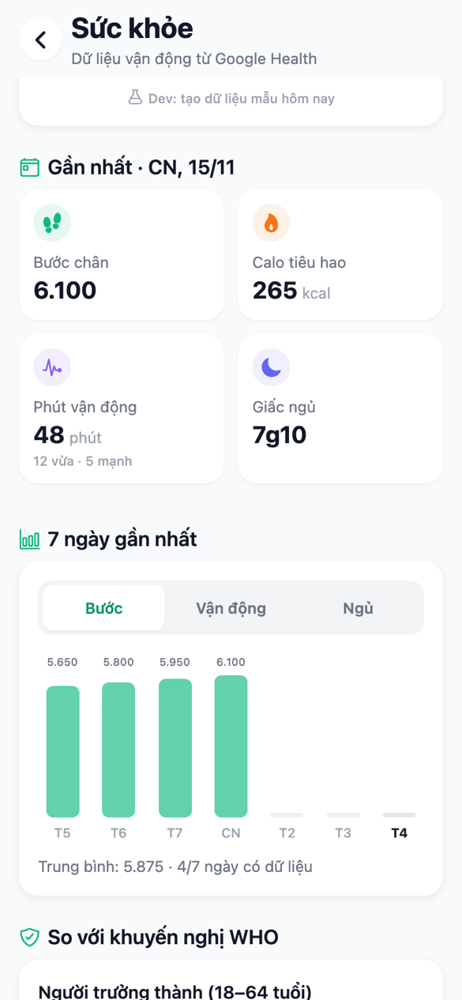
  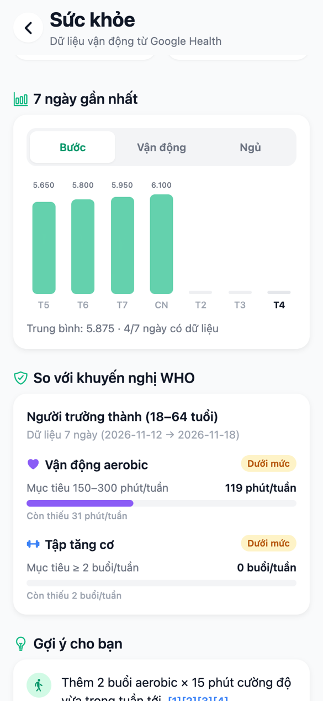

**Kết nối lần đầu**

1. Mở **Trang chủ → Vận động hôm nay → Chi tiết** (hoặc **Hồ sơ → Google Health**).
2. Bấm **Kết nối Google Health**, đăng nhập tài khoản Google và cho phép đọc dữ liệu vận động và giấc ngủ.
3. Ứng dụng tự quay lại và đồng bộ dữ liệu 7 ngày gần nhất.

**Sử dụng**

- **Đồng bộ ngay**: lấy dữ liệu mới nhất từ Google Health.
- **Ngắt**: ngừng đồng bộ. Dữ liệu đã đồng bộ vẫn được giữ.
- Các nhãn như *Bước chân, Calo, Giấc ngủ* cho biết những loại dữ liệu bạn đã cho phép.
- Nếu quyền truy cập hết hạn, ứng dụng hiện cảnh báo và nút **Kết nối lại**.

**Đọc số liệu**

- **Hôm nay / Gần nhất**: số liệu của ngày mới nhất có dữ liệu.
- **7 ngày gần nhất**: biểu đồ cột, chuyển giữa *Bước*, *Vận động* và *Ngủ*. Ngày không có dữ liệu hiện cột xám.
- **So với khuyến nghị WHO**: so mức vận động aerobic và số buổi tập tăng cơ mỗi tuần với khuyến nghị của WHO theo nhóm tuổi. Các nhãn *Đạt / Dưới mức / Vượt mức* cho biết bạn đang ở đâu.
- **Gợi ý cho bạn** và **Nguồn tham khảo**: lời khuyên kèm số trích dẫn [1], [2]… Bấm vào một nguồn để mở tài liệu gốc.

---

## 4. Tập luyện thích ứng

### 4.1 Trạng thái tập luyện

  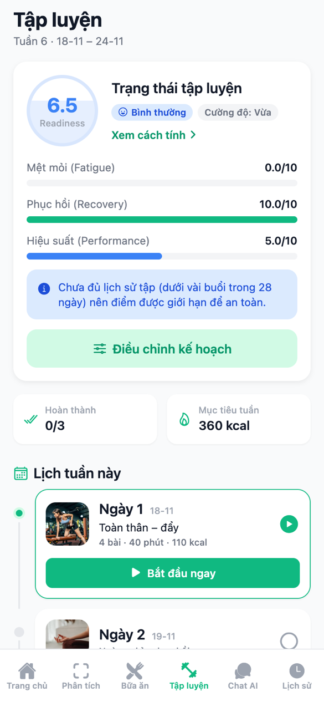
  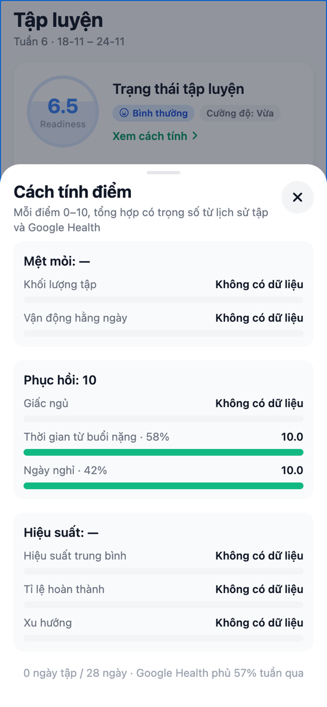

Đầu tab **Tập luyện** là thẻ trạng thái cơ thể, tính từ lịch sử tập và dữ liệu Google Health:

| Chỉ số | Ý nghĩa |
| --- | --- |
| **Readiness** (0–10) | Mức sẵn sàng tập. Càng cao càng có thể tập nặng. |
| **Mệt mỏi – Fatigue** | Khối lượng tập và vận động gần đây. Càng cao càng mệt. |
| **Phục hồi – Recovery** | Giấc ngủ, thời gian từ buổi tập nặng, số ngày nghỉ. |
| **Hiệu suất – Performance** | Hiệu suất trung bình, tỉ lệ hoàn thành buổi tập, xu hướng. |

Bấm **Xem cách tính** để xem từng thành phần và trọng số. Khi có ít lịch sử tập, điểm được giới hạn để an toàn.

Phía dưới là **Lịch tuần này**: mỗi ngày có trạng thái (đã xong, bỏ qua, hôm nay), nhóm cơ, thời lượng và calo. Ngày đã được hệ thống điều chỉnh có nhãn riêng, như *Tăng cường độ* hay *Buổi tập nhẹ*.

### 4.2 Điều chỉnh kế hoạch

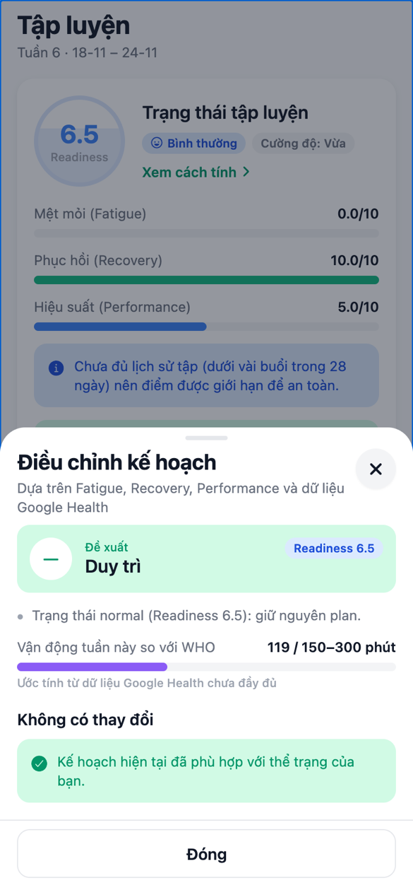

1. Bấm **Điều chỉnh kế hoạch**.
2. Hệ thống đồng bộ Google Health, phân tích thể trạng và đề xuất một trong các hướng: **Tăng cường độ, Duy trì, Giảm cường độ, Buổi tập nhẹ, Nghỉ ngơi**. Lý do được ghi kèm.
3. Xem danh sách ngày sẽ thay đổi, rồi bấm **Áp dụng** để cập nhật kế hoạch, hoặc **Để sau**.

Mỗi ngày hệ thống cũng tự điều chỉnh một lần khi bạn mở ứng dụng.

### 4.3 Đổi bài tập

  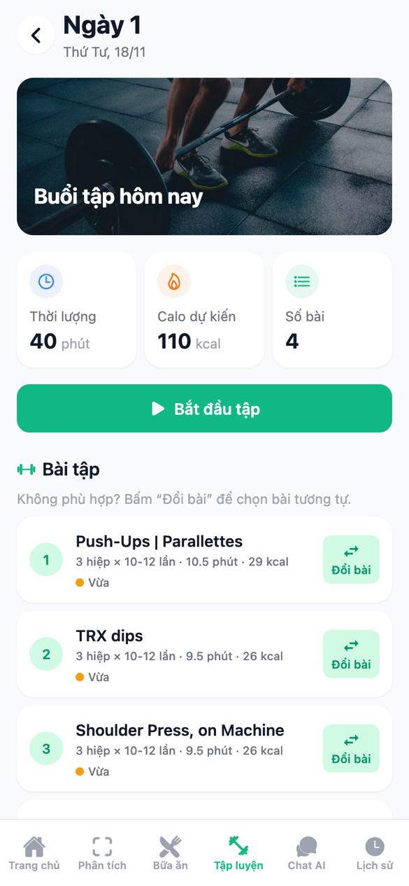
  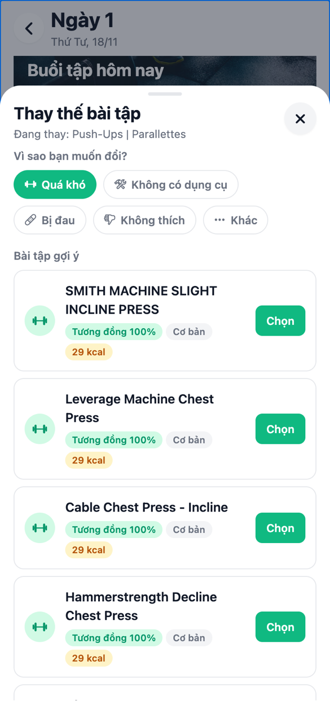

1. Chọn một ngày tập để xem chi tiết.
2. Ở bài muốn đổi, bấm **Đổi bài**.
3. Chọn lý do: *Quá khó, Không có dụng cụ, Bị đau, Không thích, Khác*.
4. Chọn một bài trong danh sách gợi ý. Mỗi bài có % tương đồng với bài gốc, độ khó, calo và dụng cụ cần dùng.

Chỉ đổi được bài ở ngày tập hôm nay hoặc sắp tới, khi bài đó chưa tập. Bài đã đổi có nhãn **Đã thay**.

Bấm **Bắt đầu tập** để vào màn tập, có đồng hồ đếm giờ và bộ đếm hiệp/lần.

---

## 5. Phân tích món ăn

  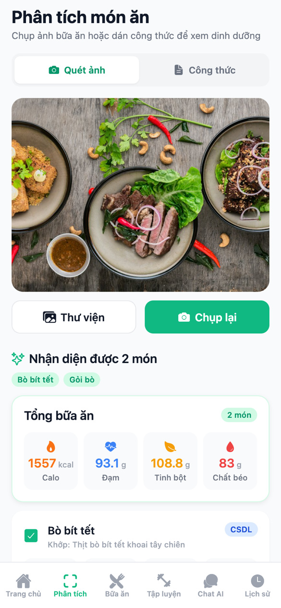
  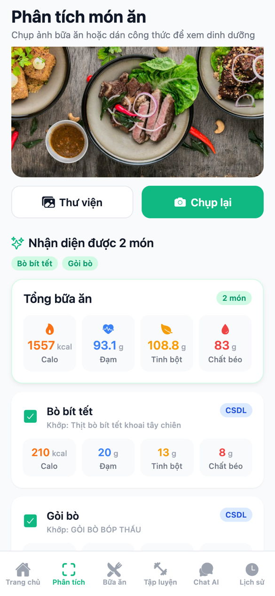

**Quét ảnh (nhận diện nhiều món)**

1. Mở tab **Phân tích**, chọn **Quét ảnh**.
2. Bấm **Chụp ảnh** hoặc **Thư viện**. Có thể chụp cả mâm cơm.
3. AI nhận diện tất cả các món trong ảnh và phân tích lần lượt từng món.
4. Mỗi món có nhãn nguồn:
   - **CSDL**: có công thức trong cơ sở dữ liệu.
   - **AI ước tính**: AI tự dựng công thức và ước tính nguyên liệu.
5. **Tổng bữa ăn** cộng dinh dưỡng các món đang được chọn. Bỏ dấu tích ở món nào thì món đó không được tính vào tổng.
6. Bấm **Xem … nguyên liệu** để xem thành phần từng món.

**Công thức**: chuyển sang **Công thức**, dán công thức hoặc danh sách nguyên liệu rồi bấm **Phân tích** để xem tổng dinh dưỡng.

> Giá trị dinh dưỡng là ước tính. Với món có ghi *Theo cả công thức*, số liệu là của toàn bộ công thức vì CSDL chưa có số khẩu phần.

---

## 6. Trợ lý AI

  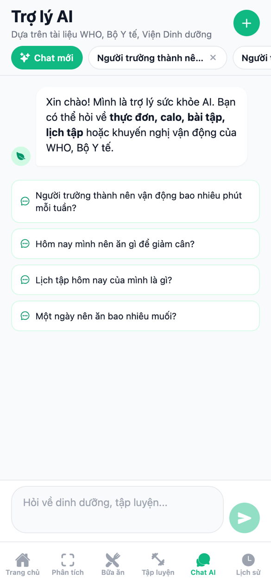
  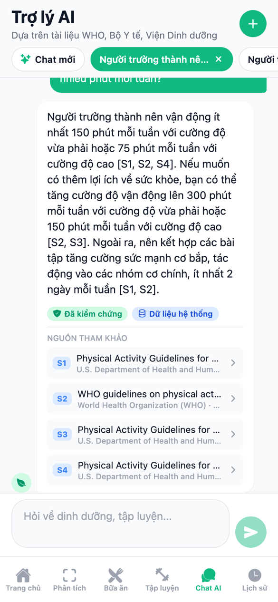
  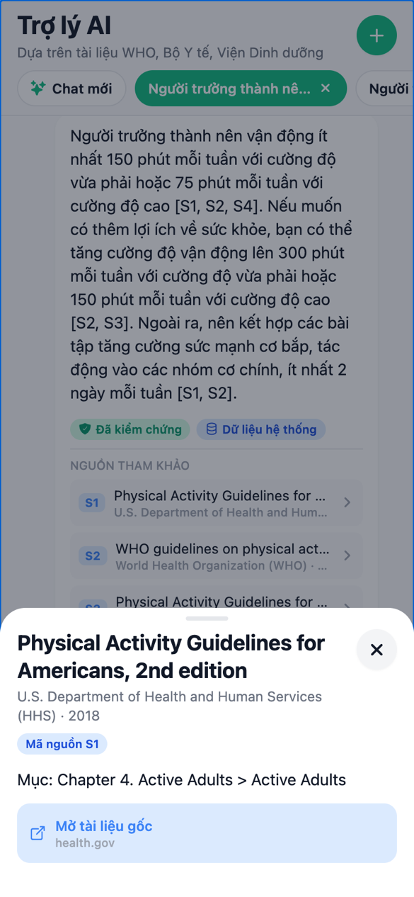

- Gõ câu hỏi về dinh dưỡng, tập luyện hay thói quen sống, hoặc bấm một **câu hỏi gợi ý**.
- Trợ lý trả lời dựa trên tài liệu chính thống (WHO, Bộ Y tế, Viện Dinh dưỡng, HHS, ACSM…) và dữ liệu cá nhân của bạn trong hệ thống.
- **Đã kiểm chứng**: câu trả lời đã qua bước kiểm tra chống bịa số liệu.
- **Nguồn tham khảo**: các mã [S1], [S2]… trong câu trả lời ứng với danh sách nguồn bên dưới. Bấm vào một nguồn để xem tên tài liệu, mục trích dẫn và mở tài liệu gốc.
- Các đoạn chat cũ nằm ở hàng trên cùng: bấm để mở lại, bấm **×** để xóa, bấm **+** hoặc **Chat mới** để bắt đầu cuộc trò chuyện mới.
- Nếu máy chủ AI bận, tin nhắn báo lỗi có nút **Gửi lại**.

> Trợ lý chỉ mang tính tham khảo, không thay thế tư vấn của bác sĩ hoặc chuyên gia dinh dưỡng.

---

## 7. Thực đơn

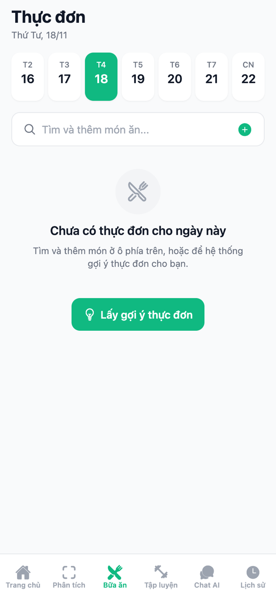

- Chọn ngày trên thanh tuần (T2–CN) để xem thực đơn của ngày đó.
- Chưa có thực đơn thì bấm **Lấy gợi ý thực đơn** để hệ thống đề xuất theo mục tiêu của bạn.
- Dùng ô **Tìm và thêm món ăn** để tự thêm món vào từng bữa.
- Ở mỗi món: đánh dấu đã ăn hoặc xóa món.

---

## 8. Lịch sử

  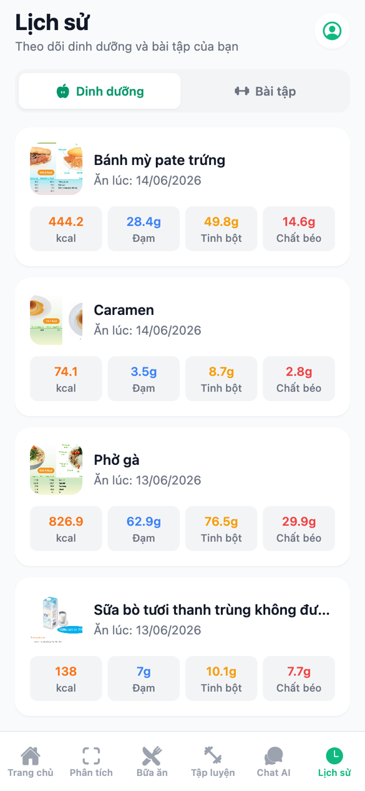
  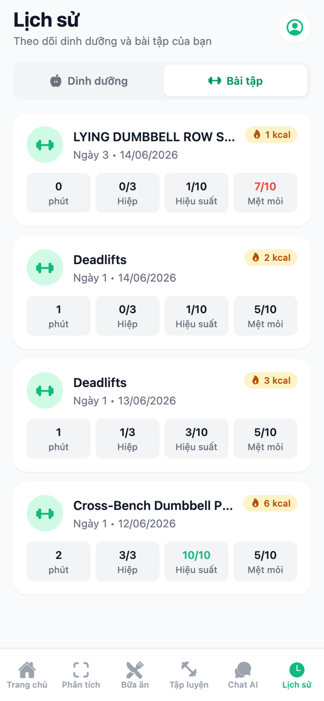

- **Dinh dưỡng**: các món đã ăn kèm calo, đạm, tinh bột, chất béo.
- **Bài tập**: các buổi đã tập kèm thời lượng, số hiệp hoàn thành, điểm hiệu suất và mức mệt mỏi.
- Kéo xuống để làm mới; cuộn xuống cuối để tải thêm.

---

## 9. Câu hỏi thường gặp

**Kết nối Google Health xong nhưng không có số liệu?**
Bấm **Đồng bộ ngay**. Google Health chỉ có dữ liệu khi điện thoại hoặc đồng hồ của bạn có ghi nhận hoạt động.

**Vì sao điểm Readiness bị giới hạn?**
Khi bạn có ít buổi tập trong 28 ngày gần nhất, hệ thống giới hạn điểm để không đề xuất tập quá sức.

**Món ăn hiện "Chưa tính được dinh dưỡng"?**
Món đó do AI ước tính và cần dịch vụ tra cứu dinh dưỡng nguyên liệu (`search-service`). Nếu dịch vụ này chưa chạy, ứng dụng vẫn hiển thị nguyên liệu nhưng chưa có số calo.
